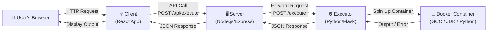
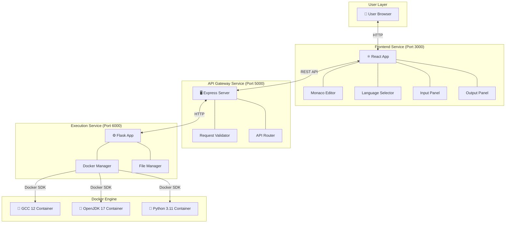
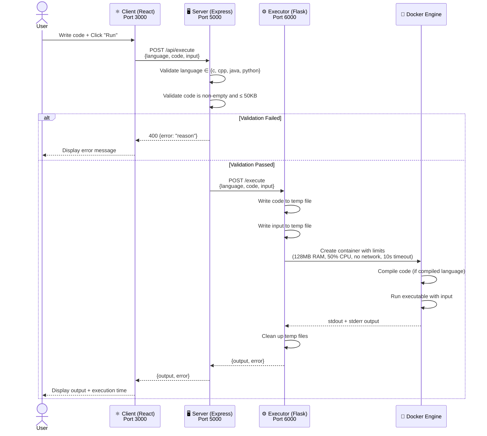
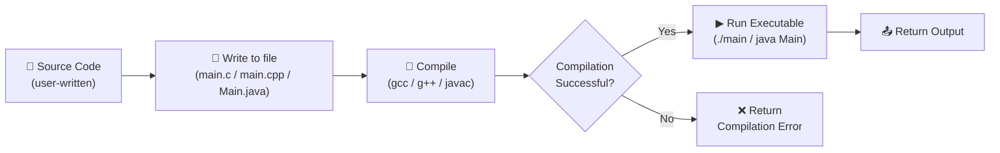
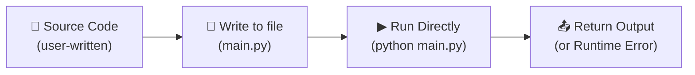

# ☁️ Cloud Compiler — Project Report

---

## Table of Contents

1. [Project Overview](#1-project-overview)
   - 1.1 [Problem Statement](#11-problem-statement)
   - 1.2 [Objectives](#12-objectives)
   - 1.3 [Scope](#13-scope)
   - 1.4 [Proposed Approach](#14-proposed-approach)
2. [System Architecture](#2-system-architecture)
   - 2.1 [High-Level Architecture Diagram](#21-high-level-architecture-diagram)
   - 2.2 [Technology Stack](#22-technology-stack)
   - 2.3 [Service Communication Flow](#23-service-communication-flow)
3. [Module Descriptions](#3-module-descriptions)
   - 3.1 [Client Module (Frontend)](#31-client-module-frontend)
   - 3.2 [Server Module (API Gateway)](#32-server-module-api-gateway)
   - 3.3 [Executor Module (Code Execution Engine)](#33-executor-module-code-execution-engine)
4. [Grammar & Language Processing](#4-grammar--language-processing)
   - 4.1 [How Code is Processed](#41-how-code-is-processed)
   - 4.2 [Language Configuration Grammar](#42-language-configuration-grammar)
   - 4.3 [Compilation Pipeline per Language](#43-compilation-pipeline-per-language)
5. [Algorithms](#5-algorithms)
   - 5.1 [Code Execution Algorithm](#51-code-execution-algorithm)
   - 5.2 [Input Validation Algorithm](#52-input-validation-algorithm)
   - 5.3 [Sandboxed Container Lifecycle Algorithm](#53-sandboxed-container-lifecycle-algorithm)
   - 5.4 [Error Classification Algorithm](#54-error-classification-algorithm)
6. [Security Considerations](#6-security-considerations)
7. [Conclusion](#7-conclusion)

---

## 1. Project Overview

### 1.1 Problem Statement

In traditional software development, writing and running code requires installing compilers, interpreters, and development tools on your local machine. For example:

- To run a **C program**, you need GCC installed.
- To run a **Java program**, you need the JDK installed.
- To run **C++ or Python**, you need their respective toolchains.

This creates several real-world problems:

| Problem | Explanation |
|---|---|
| **Installation hassle** | Setting up compilers (GCC, JDK, Python) is time-consuming and error-prone, especially for beginners who may face version conflicts or missing dependencies. |
| **Platform dependency** | Code that compiles on one OS may fail on another due to differences in system libraries, paths, or compiler versions. |
| **Security risks** | Running untrusted code directly on a local machine can harm the system — a malicious program could delete files, consume all memory, or access private data. |
| **Limited accessibility** | Students, interview candidates, or developers on shared/restricted machines (e.g., library computers, Chromebooks) often cannot install compilers at all. |

> [!IMPORTANT]
> The core problem is: **"How can we allow anyone to write and run code in multiple programming languages safely, from any device with a web browser, without installing anything?"**

---

### 1.2 Objectives

The Cloud Compiler project was built with the following clear objectives:

1. **Provide a browser-based coding environment** — Users should be able to write code using a professional-grade code editor (with syntax highlighting, auto-indentation, etc.) directly in their web browser.

2. **Support multiple programming languages** — The platform should support at least four widely-used languages: **C, C++, Java, and Python**, covering both compiled and interpreted paradigms.

3. **Execute code securely in the cloud** — User-submitted code must run in isolated, sandboxed environments (Docker containers) so that no program can harm the server or other users.

4. **Return compilation and execution results in real-time** — Users should see their program's output (or error messages) within seconds of clicking "Run."

5. **Handle user input** — Programs that require standard input (e.g., `scanf` in C, `input()` in Python) should be supported through a dedicated input panel.

6. **Enforce resource limits** — Every code execution must be constrained by time limits (10 seconds), memory limits (128 MB), and CPU limits (50%) to prevent abuse.

7. **Use a microservices architecture** — The system should be modular, with separate services for the frontend, backend API, and code execution, making it easy to scale, maintain, and deploy independently.

---

### 1.3 Scope

#### ✅ What the Project Covers (In Scope)

- A **React-based frontend** with Monaco Editor (the same editor engine used by VS Code)
- A **Node.js/Express API server** that validates requests and routes them to the executor
- A **Python/Flask executor service** that runs user code inside Docker containers
- Support for **four languages**: C (GCC 12), C++ (G++ 12), Java (OpenJDK 17), Python (3.11)
- **Containerized deployment** using Docker Compose — the entire platform can be started with a single command
- **Security sandboxing** — memory limits, CPU limits, timeouts, and network isolation
- **Standard input support** — users can provide input that their programs can read

#### ❌ What the Project Does NOT Cover (Out of Scope)

- User authentication and login systems
- Saving or sharing code snippets
- Real-time collaboration (like Google Docs)
- Support for additional languages beyond C, C++, Java, and Python
- A custom-built compiler or parser — the project delegates compilation to standard tools (GCC, javac, Python interpreter)
- Database integration

---

### 1.4 Proposed Approach

The project follows a **three-tier microservices architecture**, where each responsibility is handled by a separate, independent service:



**How it works, step by step:**

1. The **user** opens the web app in their browser, selects a programming language, writes code in the editor, optionally provides input, and clicks **"Run."**

2. The **Client** (React frontend) sends the code, language choice, and input to the **Server** via an HTTP POST request.

3. The **Server** (Node.js/Express) validates the request — checking that the language is supported, the code is not empty, and the code size is within limits (max 50 KB). If validation passes, it forwards the request to the **Executor**.

4. The **Executor** (Python/Flask) receives the request, writes the source code and input to a temporary directory, and launches a **Docker container** with the appropriate compiler/interpreter image.

5. Inside the Docker container, the code is **compiled** (for C, C++, Java) and then **executed**. For Python, it is directly interpreted. The program reads input from the provided input file.

6. The container's output (stdout + stderr) is captured, the container is automatically removed, the temporary files are cleaned up, and the result is sent back through the chain: Executor → Server → Client → User's screen.

> [!TIP]
> This approach cleanly separates concerns: the frontend handles the UI, the server handles validation and routing, and the executor handles the dangerous work of running untrusted code — all in disposable Docker containers that vanish after each execution.

---

## 2. System Architecture

### 2.1 High-Level Architecture Diagram



### 2.2 Technology Stack

| Layer | Technology | Purpose |
|---|---|---|
| **Frontend** | React 18 | Component-based user interface |
| **Code Editor** | Monaco Editor (`@monaco-editor/react`) | Professional code editing with syntax highlighting (same engine as VS Code) |
| **HTTP Client** | Axios | Making API calls from the browser to the backend |
| **Backend API** | Node.js + Express | RESTful API server for request validation and routing |
| **Body Parsing** | body-parser | Parsing JSON request bodies |
| **CORS Handling** | cors | Allowing cross-origin requests from the frontend |
| **Executor** | Python 3.11 + Flask | Lightweight web server for handling execution requests |
| **WSGI Server** | Gunicorn | Production-grade Python HTTP server |
| **Container Management** | Docker SDK for Python (`docker` library) | Programmatically creating and managing Docker containers |
| **Containerization** | Docker + Docker Compose | Packaging and orchestrating all three services |
| **C/C++ Compiler** | GCC 12 (inside Docker) | Compiling C and C++ source files |
| **Java Compiler** | OpenJDK 17 (inside Docker) | Compiling and running Java programs |
| **Python Interpreter** | Python 3.11 (inside Docker) | Running Python scripts |

### 2.3 Service Communication Flow



---

## 3. Module Descriptions

### 3.1 Client Module (Frontend)

**Location:** `client/` directory  
**Technology:** React 18, Monaco Editor, Axios  
**Port:** 3000  

The Client module is the user-facing part of the application — what people see and interact with in their web browser. It provides a clean, dark-themed IDE-like interface.

#### Components

| Component | File | Responsibility |
|---|---|---|
| **App** | `App.js` | Main application component. Manages global state (selected language, code, input, output, loading status). Coordinates communication between child components and the backend API. |
| **CodeEditor** | `components/CodeEditor.js` | Wraps the Monaco Editor to provide a VS Code-like code editing experience with syntax highlighting, auto-completion, and auto-indentation for each supported language. |
| **LanguageSelector** | `components/LanguageSelector.js` | A dropdown menu that lets the user pick from Python 🐍, C ⚙️, C++ ⚡, or Java ☕. When the user switches languages, the editor automatically loads a "Hello, World!" template for that language. |
| **InputPanel** | `components/InputPanel.js` | A text area where users can type input that their program will receive via standard input (stdin). Useful for programs that use `scanf()`, `cin >>`, `input()`, etc. |
| **OutputPanel** | `components/OutputPanel.js` | Displays the program's output after execution. Also shows the total execution time in milliseconds. If there's an error (compilation error, runtime error, or timeout), it's displayed here in a clear format. |

#### How the Frontend Works (in simple terms)

Think of the frontend as the **"face"** of the application. It doesn't compile or run any code itself — it's just a smart form that:
1. Collects what the user types (code + input)
2. Sends it to the backend server
3. Waits for the result
4. Shows the result on screen

---

### 3.2 Server Module (API Gateway)

**Location:** `server/` directory  
**Technology:** Node.js, Express, Axios  
**Port:** 5000  

The Server module acts as a **middleman** (or "gateway") between the frontend and the executor. Its job is to receive requests from the browser, make sure they're valid, and then forward them to the executor service.

#### API Endpoints

| Method | Endpoint | Purpose |
|---|---|---|
| `GET` | `/api/health` | Returns `{"status": "ok"}` — used to check if the server is alive |
| `GET` | `/api/languages` | Returns a list of supported languages with their compiler versions |
| `POST` | `/api/execute` | Accepts `{language, code, input}`, validates the request, forwards it to the executor, and returns the result |

#### Why a Separate Server?

You might wonder: *"Why not have the frontend talk directly to the executor?"* There are good reasons:

1. **Validation**: The server catches bad requests before they reach the executor (wrong language, empty code, oversized code).
2. **Security**: The executor service (which has access to Docker) is never directly exposed to the internet.
3. **Abstraction**: If we later want to add features like logging, rate limiting, user authentication, or caching, we add them here without touching the executor.
4. **Timeout handling**: The server enforces a 30-second timeout on requests to the executor, preventing indefinitely hanging connections.

---

### 3.3 Executor Module (Code Execution Engine)

**Location:** `executor/` directory  
**Technology:** Python 3.11, Flask, Docker SDK  
**Port:** 6000  

The Executor is the **heart of the system** — it's the service that actually runs user code. It does this by creating short-lived Docker containers, each pre-loaded with the correct compiler or interpreter.

#### Language Configuration

The executor uses a configuration dictionary that maps each language to its Docker image, filename, compile command, and run command:

| Language | Docker Image | Source File | Compile Command | Run Command |
|---|---|---|---|---|
| **C** | `gcc:12` | `main.c` | `gcc -o main main.c -lm` | `./main` |
| **C++** | `gcc:12` | `main.cpp` | `g++ -o main main.cpp -lm` | `./main` |
| **Java** | `openjdk:17-slim` | `Main.java` | `javac Main.java` | `java Main` |
| **Python** | `python:3.11-slim` | `main.py` | *(none — interpreted)* | `python main.py` |

#### Container Security Limits

Every container is created with strict resource limits to prevent abuse:

| Limit | Value | Why |
|---|---|---|
| **Memory** | 128 MB | Prevents programs from consuming all server RAM (e.g., infinite array allocation) |
| **CPU** | 50% of one core | Prevents CPU-intensive programs (e.g., infinite loops doing heavy math) from starving other processes |
| **Timeout** | 10 seconds | Kills programs that run too long (e.g., infinite loops, deadlocks) |
| **Network** | Disabled | Prevents code from making network calls (e.g., downloading malware, attacking other servers) |
| **Auto-Remove** | Enabled | Container is automatically deleted after execution, leaving no traces |

---

## 4. Grammar & Language Processing

### 4.1 How Code is Processed

The Cloud Compiler **does not implement its own compiler or parser**. Instead, it takes a delegation approach: it relies on industry-standard, battle-tested compilers and interpreters that run inside Docker containers.

In simple terms:
- **We don't reinvent the wheel.** GCC, javac, and the Python interpreter have been developed and refined by thousands of engineers over decades.
- **Our job is orchestration** — we handle taking the user's code, placing it in the right environment, running the right compiler, capturing the output, and sending it back.

> [!NOTE]
> This is a deliberate architectural decision. Building a custom compiler for even one language would be a massive undertaking. By delegating to standard tools, we get correct, optimized compilation for free, and can focus on the platform aspects (UI, security, scalability).

### 4.2 Language Configuration Grammar

While the project doesn't use a formal grammar in the traditional compiler-theory sense (like BNF or Context-Free Grammars), it does define a **structured configuration grammar** that governs how each language is processed. This configuration acts as a "recipe" for the executor:

```
LanguageConfig ::= {
    "image"       : DockerImageName,
    "filename"    : SourceFileName,
    "compile_cmd" : CompileCommand | None,
    "run_cmd"     : RunCommand
}

DockerImageName  ::= string       (* e.g., "gcc:12", "python:3.11-slim" *)
SourceFileName   ::= string       (* e.g., "main.c", "Main.java" *)
CompileCommand   ::= string       (* e.g., "gcc -o main main.c -lm" *)
RunCommand       ::= string       (* e.g., "./main", "python main.py" *)
```

The executor uses this configuration to dynamically build the correct shell command for each language.

### 4.3 Compilation Pipeline per Language

#### For Compiled Languages (C, C++, Java):



**Step-by-step (C example):**
1. User writes: `#include <stdio.h> ...`
2. Executor saves it as `main.c`
3. GCC compiles it: `gcc -o main main.c -lm`
4. If compilation succeeds → run `./main` with the user's input
5. If compilation fails → return the error message (e.g., "undefined reference to 'foo'")

#### For Interpreted Languages (Python):



**Step-by-step (Python example):**
1. User writes: `print("Hello")`
2. Executor saves it as `main.py`
3. Python interpreter runs it directly: `python main.py`
4. Output is captured and returned

---

## 5. Algorithms

### 5.1 Code Execution Algorithm

This is the main algorithm that powers the entire system. Here's how it works in plain English, followed by structured pseudocode:

**In simple words:** *"Take the user's code, put it in a safe box (Docker container), run it with the right tools, grab the output, throw away the box, and send back the result."*

```
ALGORITHM: ExecuteCode(language, code, input)

INPUT:  language ∈ {c, cpp, java, python}
        code     — the user's source code (string)
        input    — the user's stdin input (string)
OUTPUT: {output, error} — the program's output or an error message

BEGIN
    1.  config ← LANGUAGE_CONFIG[language]
    
    2.  temp_dir ← CREATE temporary directory on host filesystem
    
    3.  WRITE code → temp_dir / config.filename
        WRITE input → temp_dir / "input.txt"
    
    4.  IF config.compile_cmd IS NOT NULL THEN
            // Compiled language (C, C++, Java)
            command ← "cd /code && " + config.compile_cmd + " 2>&1 && "
                       + config.run_cmd + " < input.txt 2>&1"
        ELSE
            // Interpreted language (Python)
            command ← "cd /code && " + config.run_cmd + " < input.txt 2>&1"
        END IF
    
    5.  container ← DOCKER.RUN(
            image        = config.image,
            command      = ["sh", "-c", command],
            volumes      = {temp_dir → "/code"},
            mem_limit    = "128m",
            cpu_quota    = 50%,
            network      = DISABLED,
            timeout      = 10 seconds,
            auto_remove  = TRUE
        )
    
    6.  output ← CAPTURE container's stdout + stderr
    
    7.  DELETE temp_dir (cleanup)
    
    8.  RETURN {output: output, error: null}

EXCEPTION HANDLING:
    - ContainerError    → RETURN {output: "", error: stderr_message}
    - TimeoutError      → RETURN {output: "", error: "Time Limit Exceeded (10s)"}
    - APIError          → RETURN {output: "", error: "Execution error: details"}
    - AnyOtherError     → RETURN {output: "", error: "Runtime error: details"}
    - FINALLY           → DELETE temp_dir (always clean up)
END
```

---

### 5.2 Input Validation Algorithm

Before any code is executed, the Server module validates the incoming request to catch obvious problems early:

```
ALGORITHM: ValidateRequest(request)

INPUT:  request — JSON body with {language, code, input}
OUTPUT: PASS or REJECT with error message

BEGIN
    1.  supported ← ["c", "cpp", "java", "python"]
    
    2.  IF request.language IS NULL OR request.language ∉ supported THEN
            REJECT with "Unsupported language"
        END IF
    
    3.  IF request.code IS NULL OR TRIM(request.code) IS EMPTY THEN
            REJECT with "Code cannot be empty"
        END IF
    
    4.  IF LENGTH(request.code) > 50,000 bytes THEN
            REJECT with "Code too large (max 50KB)"
        END IF
    
    5.  PASS — forward request to Executor
END
```

**Why each check matters:**
- **Language check**: Prevents the executor from receiving a request for a language it can't handle (e.g., "ruby"), which would crash.
- **Empty code check**: There's no point executing nothing — saves resources.
- **Size check**: A 50 KB limit prevents someone from sending a gigantic file that wastes memory and processing time.

---

### 5.3 Sandboxed Container Lifecycle Algorithm

This algorithm describes how each Docker container is created, used, and destroyed:

```
ALGORITHM: ContainerLifecycle(config, temp_dir, command)

BEGIN
    ┌──────────────────────────────────────────────┐
    │  PHASE 1: CREATION                           │
    │  • Pull Docker image (if not cached)         │
    │  • Create container with resource limits     │
    │  • Mount temp_dir as /code inside container  │
    │  • Disable network access                    │
    └──────────────────┬───────────────────────────┘
                       │
    ┌──────────────────▼───────────────────────────┐
    │  PHASE 2: EXECUTION                          │
    │  • Run compile command (if applicable)       │
    │  • Run the compiled/interpreted program      │
    │  • Feed input.txt via stdin redirection      │
    │  • Capture all stdout and stderr             │
    └──────────────────┬───────────────────────────┘
                       │
    ┌──────────────────▼───────────────────────────┐
    │  PHASE 3: TERMINATION                        │
    │  • Container exits naturally, OR             │
    │  • Container is killed after 10s timeout, OR │
    │  • Container is killed if memory exceeded    │
    └──────────────────┬───────────────────────────┘
                       │
    ┌──────────────────▼───────────────────────────┐
    │  PHASE 4: CLEANUP                            │
    │  • Container is auto-removed (remove=True)   │
    │  • Temporary directory is deleted (finally)  │
    │  • No traces left on the host system         │
    └──────────────────────────────────────────────┘
END
```

---

### 5.4 Error Classification Algorithm

The system handles errors at multiple levels, classifying them so the user gets a meaningful message:

```
ALGORITHM: ClassifyError(exception)

BEGIN
    IF exception IS ContainerError THEN
        // The program compiled but crashed at runtime
        // (e.g., segfault in C, NullPointerException in Java)
        RETURN "Runtime Error: " + stderr output
    
    ELSE IF exception contains "timed out" or "timeout" THEN
        // The program ran longer than 10 seconds
        // (e.g., infinite loop)
        RETURN "Time Limit Exceeded (10s)"
    
    ELSE IF exception IS Docker APIError THEN
        // Something went wrong with Docker itself
        // (e.g., image not found, Docker daemon not running)
        RETURN "Execution Error: " + details
    
    ELSE IF HTTP request to executor times out (30s) THEN
        // The entire request took too long (server-level)
        RETURN "Execution timed out"
    
    ELSE IF HTTP request to executor fails THEN
        // Network error, executor service is down
        RETURN "Failed to execute code"
    
    ELSE
        // Unexpected error
        RETURN "Runtime Error: " + details
    END IF
END
```

**Compilation errors** (like syntax errors) are not exceptions — they appear in the command's stderr output and are returned as normal output with the error field set.

---

## 6. Security Considerations

Security is critical because the system runs **arbitrary, untrusted code** from unknown users. Here's how the project protects against common attack vectors:

| Threat | Protection | How It Works |
|---|---|---|
| **Fork bomb** (`:(){ :\|:& };:`) | Memory + CPU limits | Container is limited to 128 MB RAM and 50% CPU; the fork bomb quickly exhausts the container's resources and the container is killed, not the host. |
| **Infinite loop** (`while(1){}`) | 10-second timeout | Container is forcefully terminated after 10 seconds. |
| **Memory bomb** (allocating infinite memory) | 128 MB memory limit | The container's memory is hard-capped; allocations beyond the limit cause the program to crash or the container to be killed by the OOM (Out of Memory) killer. |
| **Network attacks** (sending HTTP requests, port scanning) | Network disabled | `network_disabled=True` means the container has no network interface — it literally cannot make any network connections. |
| **File system damage** (deleting system files) | Container isolation | The container only has access to `/code` (a temp directory). The host filesystem is not accessible. After execution, the container and temp directory are both deleted. |
| **Oversized code submission** | 50 KB code size limit | The server rejects any code larger than 50 KB before it reaches the executor. |
| **Invalid requests** | Input validation | The server validates language, code presence, and size before forwarding. |

> [!CAUTION]
> While these protections are robust for a project/educational setting, a production-grade system would additionally need: rate limiting per user/IP, user authentication, a queue system for concurrent executions, Docker image pre-pulling, and more advanced kernel-level isolation (e.g., gVisor or Firecracker).

---

## 7. Conclusion

The **Cloud Compiler** is a full-stack, cloud-based code compilation and execution platform that solves the real problem of needing local compiler installations. By combining a modern React frontend with an industry-grade Monaco code editor, a validating Node.js API gateway, and a secure Python-based executor that runs code in disposable Docker containers, the system provides a safe, fast, and accessible way for anyone to write and run code in C, C++, Java, or Python — right from their browser.

The microservices architecture ensures that each component can be developed, tested, deployed, and scaled independently. The security sandbox — with memory limits, CPU quotas, timeouts, and network isolation — ensures that even malicious or buggy code cannot harm the server or other users.

This project demonstrates key software engineering principles including **separation of concerns**, **containerization**, **API design**, **input validation**, and **defense-in-depth security** — making it both a practical tool and a valuable learning exercise.

---

> *Report generated for the Cloud Compiler project.*  
> *Based on source code analysis of the `client/`, `server/`, and `executor/` modules.*
