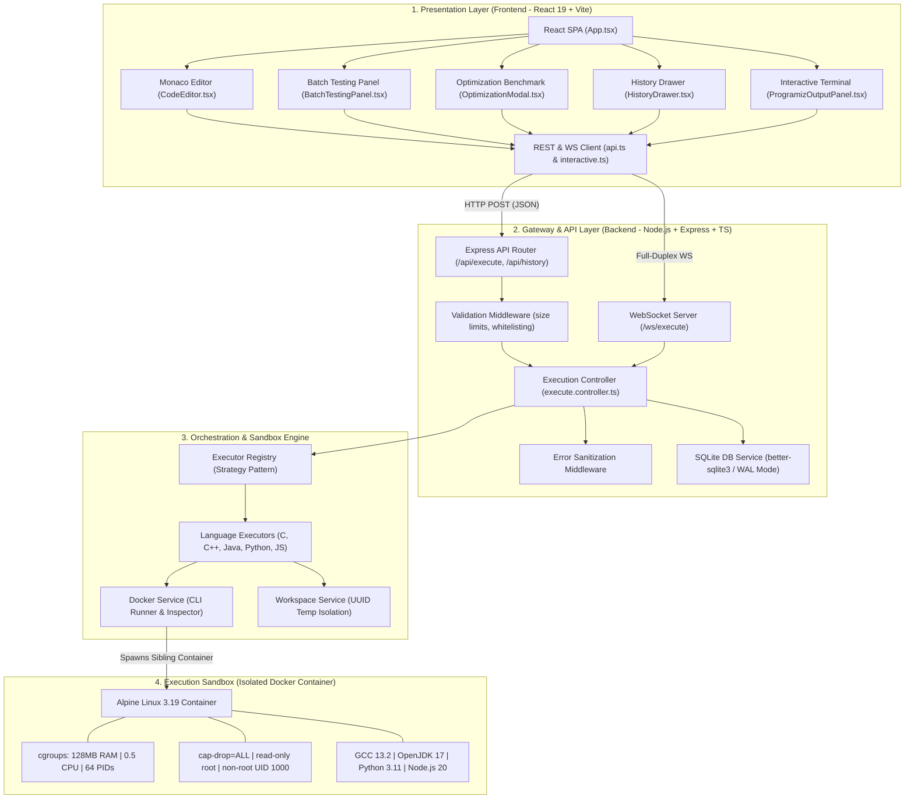
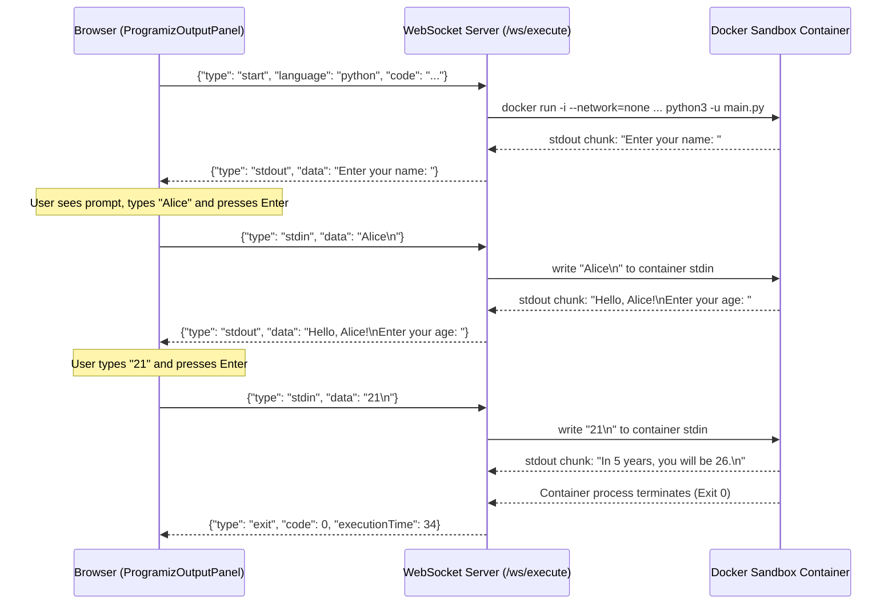
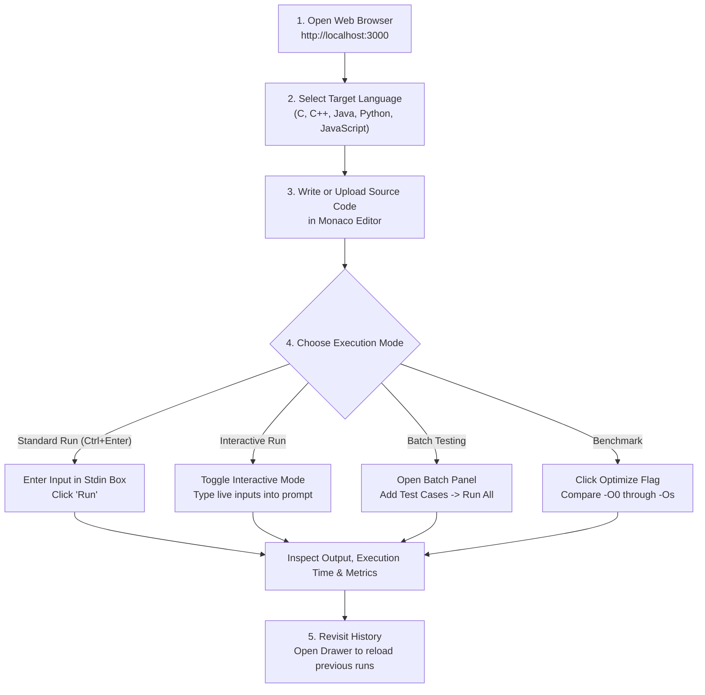
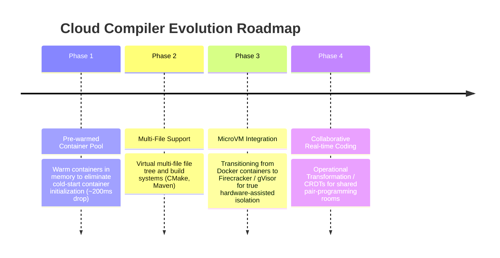

# ☁️ Cloud Compiler — Module Implementation, Workflow & Testing Report

---

## 🔗 Repository Information

- **GitHub Repository**: [https://github.com/bajoriapranad/cloud-compiler.git](https://github.com/bajoriapranad/cloud-compiler.git)
- **Primary Languages**: TypeScript, React, Python, C/C++, Java, Shell/PowerShell
- **Architecture**: Distributed Cloud Execution Architecture (React 19 SPA + Node.js/Express API & WebSocket Engine + Multi-Language Alpine Docker Sandbox + SQLite WAL Persistence)

---

## 1. Implemented Modules and How They Work Together

The system is organized into modular subsystems operating with clear separation of concerns:



### Detailed Breakdown of Subsystems

#### A. Frontend Module (`/frontend`)
1. **`CodeEditor.tsx`**: Wraps Microsoft's Monaco Editor. Integrates custom GitHub Dark and Light themes, multi-language switching, compile-time flags, custom memory/time thresholds, and file upload/download utilities.
2. **`ProgramizOutputPanel.tsx`**: Renders real-time interactive stdout streams and features an inline interactive input box to pipe characters directly into active programs.
3. **`BatchTestingPanel.tsx`**: Multi-test harness allowing developers to enter up to 6 input/expected-output pairs, execute them in batch mode, and visually inspect diffs and pass/fail states.
4. **`OptimizationModal.tsx`**: Visual benchmark dashboard displaying binary footprint (in bytes) and runtime latency across GCC flags (`-O0`, `-O1`, `-O2`, `-O3`, `-Os`) using bar charts.
5. **`HistoryDrawer.tsx`**: Slide-out drawer querying past execution records from SQLite, enabling 1-click restoration of previously compiled code.

#### B. API Gateway & Controller Layer (`/backend/src`)
1. **`execute.controller.ts`**: Coordinates single runs, batch jobs, compiler benchmark loops, and database logging.
2. **`validation.middleware.ts`**: Protects the infrastructure against resource exhaustion by enforcing:
   - Source code size $\le 100\text{ KB}$
   - Stdin size $\le 32\text{ KB}$
   - Language strict whitelisting (`c`, `cpp`, `java`, `python`, `javascript`)
3. **`db.service.ts`**: High-performance SQLite persistence with `WAL` (Write-Ahead Logging) journaling, recording submission IDs, status, execution metrics, and outputs.

#### C. Execution Engine & Strategy Layer
1. **`BaseExecutor` & Concrete Implementations**:
   - `CExecutor`: Compiles with `gcc -O2 main.c -o main -lm`
   - `CppExecutor`: Compiles with `g++ -O2 -std=c++17 main.cpp -o main`
   - `JavaExecutor`: Compiles via `javac Main.java` and executes on JVM with `-Xmx64m -XX:+UseSerialGC`
   - `PythonExecutor`: Runs unbuffered `python3 -u main.py`
   - `JavaScriptExecutor`: Runs on Node.js with `--max-old-space-size=64`
2. **`WorkspaceService.ts`**: Allocates an ephemeral directory tagged with UUID (`/tmp/cloud-compiler-workspaces/exec-{uuid}`) mounted into the container as `/workspace:rw`, which is wiped immediately after execution completes.
3. **`DockerService.ts`**: Communicates directly with the Docker socket (`/var/run/docker.sock`) using child processes to spin up isolated sibling containers on demand.

---

## 2. Complete Input-to-Output Demonstrations

### Demonstration 1: Standard REST Execution with Pre-set Stdin (C++)

#### Input Code (`main.cpp`):
```cpp
#include <iostream>
#include <vector>
#include <numeric>

int main() {
    int n;
    if (!(std::cin >> n)) return 0;
    std::vector<long long> arr(n);
    for (int i = 0; i < n; i++) {
        std::cin >> arr[i];
    }
    long long sum = std::accumulate(arr.begin(), arr.end(), 0LL);
    std::cout << "Count: " << n << "\nSum: " << sum << std::endl;
    return 0;
}
```

#### Pre-set Stdin:
```text
5
10 20 30 40 50
```

#### JSON Response Received by Frontend:
```json
{
  "id": "sub_a9f1c42b",
  "status": "SUCCESS",
  "stdout": "Count: 5\nSum: 150\n",
  "stderr": "",
  "compileTime": 248,
  "executionTime": 14,
  "exitCode": 0
}
```
**UI Display**: Metrics bar updates to show green `SUCCESS`, compile time `248ms`, run time `14ms`, and output renders in the terminal.

---

### Demonstration 2: Live Bidirectional Interactive Execution (Python via WebSocket)

#### Input Code (`main.py`):
```python
name = input("Enter your name: ")
print(f"Hello, {name}!")
age = int(input("Enter your age: "))
print(f"In 5 years, you will be {age + 5}.")
```

#### Step-by-Step Interactive Workflow:


---

### Demonstration 3: Batch Test Runner (C Competitive Programming Model)

- **Problem**: Check whether input number is prime.
- **Batch Test Setup in UI**:
  - Test Case 1: Stdin: `7` | Expected: `PRIME`
  - Test Case 2: Stdin: `4` | Expected: `COMPOSITE`
  - Test Case 3: Stdin: `1` | Expected: `NEITHER`
- **Backend Flow**:
  1. The code is compiled **once** into an executable (`main`).
  2. The backend loops through all test cases, feeding each into `./main`.
  3. Returns a structured array with pass/fail evaluations and runtime metrics for each test.
- **Frontend Presentation**:
  - Test 1: `PASS` (Output matched `PRIME`, 8ms)
  - Test 2: `PASS` (Output matched `COMPOSITE`, 9ms)
  - Test 3: `PASS` (Output matched `NEITHER`, 7ms)

---

### Demonstration 4: GCC Optimization Benchmark (-O0 vs -O3 vs -Os)

When testing a computational loop in C++ (`/api/execute/optimize`):
- `-O0` (No optimization): Binary size: ~`28.4 KB` | Execution: `142 ms`
- `-O2` (Standard release): Binary size: ~`24.2 KB` | Execution: `18 ms`
- `-O3` (Aggressive loop vectorization): Binary size: ~`26.1 KB` | Execution: `9 ms`
- `-Os` (Size optimized): Binary size: ~`18.8 KB` | Execution: `24 ms`

The `OptimizationModal` presents this data in an interactive comparative bar chart.

---

## 3. Test Results, Error Handling, and Known Limitations

### Error Handling Matrix

The engine intercepts container and POSIX signals, converting low-level faults into user-friendly diagnostic statuses:

| Fault Scenario | Trigger / Code Example | Exit Code / Signal | System Status | User Explanation |
|---|---|---|---|---|
| **Syntax Error** | `int x = ;` (C++) | Exit `1` | `COMPILE_ERROR` | Compiler error log from GCC/javac returned directly. |
| **Segmentation Fault** | `int *p = NULL; *p = 1;` | Exit `139` (`SIGSEGV`) | `RUNTIME_ERROR` | Program tried to read/write unallocated memory. |
| **Division by Zero** | `int y = 10 / 0;` | Exit `136` (`SIGFPE`) | `RUNTIME_ERROR` | Erroneous arithmetic operation (floating point exception). |
| **Memory Limit Exceeded (MLE)** | Allocating large vectors (>128MB) | Exit `137` (`SIGKILL` by OOM) | `MEMORY_LIMIT_EXCEEDED` | Linux cgroup OOM killer terminated the container. |
| **Time Limit Exceeded (TLE)** | `while(true) {}` | Timeout triggered | `TIME_LIMIT_EXCEEDED` | Process killed after reaching timeout (3-5s limit). |
| **Network Abuse** | `urllib.request.urlopen(...)` | `URLError` / `SocketError` | `RUNTIME_ERROR` | Connection refused immediately (`--network=none`). |
| **Privilege Escalation** | `setuid(0)` or modifying `/etc` | `EPERM` / Read-only FS | `RUNTIME_ERROR` | Blocked by `--cap-drop=ALL` and `--read-only`. |

### Known Limitations

1. **Cold Container Startup Overhead**:
   - Because each run spawns a fresh `docker run` process, there is a baseline process initiation latency (~200ms–400ms per run).
   - *Mitigation in progress*: Pre-warmed container pools.
2. **Sibling Docker Daemon Dependency**:
   - The backend needs access to `/var/run/docker.sock` to orchestrate sandbox containers. In managed cloud environments where mounting the host Docker socket is restricted (e.g., standard AWS Fargate or Heroku), custom worker VMs or Kubernetes CRI integrations are required.
3. **Sequential Batch Test Execution**:
   - Batch test cases are executed sequentially rather than in parallel to avoid CPU starvation under the 0.5 CPU limit.
4. **Single-File Scope**:
   - Currently, projects are limited to single-file submissions (`main.c`, `Main.java`, `main.py`). Multi-file packages or custom external dependencies (`pip`, `npm`) are not yet supported.

---

## 4. Installation and Workflow Guide

### Prerequisites
- [Docker Desktop](https://www.docker.com/products/docker-desktop/) (running with Linux containers enabled)
- [Node.js](https://nodejs.org/) v18 or higher
- [Git](https://git-scm.com/)

---

### Step 1: Clone the Repository
```bash
git clone https://github.com/bajoriapranad/cloud-compiler.git
cd cloud-compiler
```

---

### Step 2: Build the Unified Sandbox Container
The sandbox container holds GCC, OpenJDK, Python, and Node.js. Build it locally:

**On Windows (PowerShell):**
```powershell
./docker/build-sandbox.ps1
```

**On Linux / macOS:**
```bash
chmod +x ./docker/build-sandbox.sh
./docker/build-sandbox.sh
```

*(Alternatively, via standard Docker CLI):*
```bash
docker build -t cloud-compiler-sandbox:latest -f docker/Dockerfile.sandbox .
```

---

### Step 3: Run with Docker Compose (Recommended)

To start both the Backend API server and Frontend Nginx server in production mode:

```bash
docker-compose up --build
```

- **Frontend Application**: Accessible at `http://localhost:3000`
- **Backend API & Healthcheck**: Accessible at `http://localhost:5000/api/health`

---

### Step 4: Local Development Mode (Optional)

If developing locally with hot reload:

#### 1. Setup Backend:
```bash
cd backend
cp .env.example .env
npm install
npm run dev
```
*(Backend runs on `http://localhost:5000`)*

#### 2. Setup Frontend:
```bash
cd frontend
npm install
npm run dev
```
*(Frontend runs on `http://localhost:5173` via Vite)*

---

### End-User Operational Workflow



---

## 5. Conclusion and Future Improvements

### Conclusion
The **Cloud Compiler** provides a containerized code execution platform combining high performance, clean UI, and sandboxing. By pairing **React 19** and the **Monaco Editor** with an **Express/WebSocket API** and a hardened **Alpine Docker sandbox**, it delivers:
- Near-instantaneous response times for small scripts
- Bidirectional live standard I/O for interactive learning
- Strong multi-layer defense against malicious code execution
- Detailed performance insights via optimization benchmarks and test-case harnesses

### Future Improvements Roadmap



1. **Pre-warmed Container Pooling**: Maintaining a pool of 2–3 running, idle sandbox containers ready to immediately receive code mounts, reducing execution latency from ~300ms to <50ms.
2. **MicroVM Migration (AWS Firecracker / gVisor)**: Upgrading from shared Linux kernel containers to lightweight MicroVMs for defense against kernel zero-days.
3. **Language Server Protocol (LSP)**: Connecting Monaco Editor to backend language servers for real-time IntelliSense, syntax diagnosis, and autocomplete.
4. **Collaborative Pair Programming**: Using WebSockets and CRDTs (e.g., Yjs) to enable multi-user simultaneous code collaboration.
